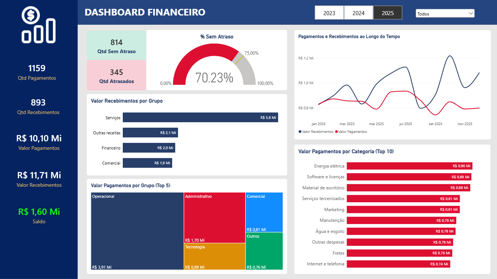
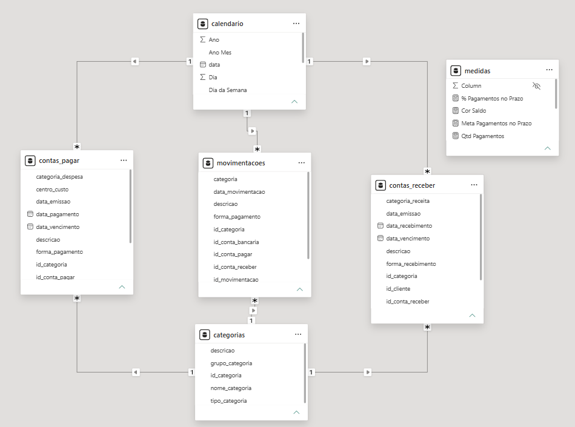

# Dashboard Financeiro - Power BI

Projeto de análise financeira desenvolvido com Power BI, com foco no acompanhamento de pagamentos, recebimentos, despesas e saldo de caixa.

## Dashboard




## Objetivo

Desenvolver um dashboard interativo para acompanhar indicadores financeiros, analisar a distribuição das despesas por grupo e categoria, monitorar pagamentos e recebimentos ao longo do tempo e acompanhar o saldo de caixa.

## Ferramentas Utilizadas

- **Power BI Desktop** - criação do dashboard e visualização dos dados.
- **Power Query** - transformação e preparação dos dados.
- **DAX** - criação de medidas e indicadores financeiros.
- **Excel** - armazenamento da base de dados.

## Indicadores e Análises

- Saldo de caixa.
- Valores totais de pagamentos e recebimentos.
- Quantidade de pagamentos e recebimentos.
- Pagamentos realizados dentro e fora do prazo.
- Contas a pagar e a receber em atraso.
- Despesas por grupo e categoria.
- Evolução temporal de pagamentos e recebimentos.

## Modelagem de Dados

O projeto utiliza um modelo dimensional com tabelas de fatos e dimensões compartilhadas, permitindo analisar as movimentações financeiras por período e categoria.

Tabelas:

- `contas_pagar`
- `contas_receber`
- `movimentacoes`
- `categorias`
- `calendario`


## Modelo de Dados



## Estrutura do Repositório

```text
powerbi-dashboard-financeiro/
├── data/
│   └── base_financeira_power_bi.xlsx
├── dashboard_financeiro.pbix
├── dashboard_preview.png
├── modelagem_dados.png
└── README.md
```

## Fonte dos Dados

Base de dados sintética criada para fins de estudo e desenvolvimento do projeto. Os registros não representam transações de uma empresa real.

## Aprendizados

- Construção de dashboards financeiros interativos.
- Criação de medidas e indicadores com DAX.
- Modelagem de dados com tabelas de fatos e dimensões.
- Análise de fluxo de caixa, despesas e pagamentos.
- Utilização de segmentações e hierarquias temporais.